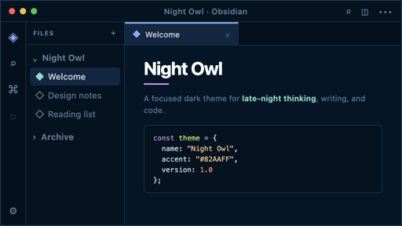

# Night Owl Classic

This repository preserves the discontinued **Night Owl** Obsidian theme formerly distributed from `AstroAir/obsidian-night-owl`. The recovered CSS is published unchanged so existing users can install the same theme in new vaults.

> Preservation status: Max Qian/AstroAir remains credited as the author of the recovered theme. Mark Spirek maintains this preservation repository and does not claim original authorship. The Community directory still has an archived `night-owl` listing under astroair, so this copy is listed as **Night Owl Classic**. Directory names cannot include the word "Theme".

## Install

1. Download `manifest.json` and `theme.css` from the [1.0.3 release](https://github.com/mspirek/night-owl-classic/releases/tag/1.0.3).
2. In the target vault, create `.obsidian/themes/Night Owl Classic/`.
3. Put both downloaded files in that folder.
4. In Obsidian, open **Settings → Appearance → Themes** and select **Night Owl Classic**.

## Integrity

| File | SHA-256 |
| --- | --- |
| `manifest.json` (`1.0.3`) | `fb1adb858ffbed415bb84206b0b53c615ab23f2699cc9ee475c449c2743690f3` |
| `theme.css` (unchanged from recovered `1.0.0`) | `2f503a22fdc0f8abf88e5200135b928128152c7e071c924d69f892b5568a4ba9` |

The recovered `1.0.0` manifest hash remains `0cac7a349633006aa250493899ec5c04eed2875bd2ef7cded7b692eee288e4c4`. Version `1.0.3` only changes the listing name and version so the Community directory can accept the theme.

Run `./scripts/verify-release.sh` from the repository root to verify both files, the manifest contents, and the lack of remote-loading CSS.

## Provenance

- Night Owl entered the Obsidian theme registry in 2021 under Ben Hong's `bencodezen/obsidian-night-owl-theme` project.
- The official registry was updated in November 2025 to list Max Qian and `AstroAir/obsidian-night-owl`.
- The AstroAir account and repository later became unavailable, and Night Owl disappeared from the registry in an automated update in May 2026. No maintainer statement explaining the discontinuation has been found, so this repository does not claim a definitive reason.
- These 1.0.0 files were recovered from an existing Obsidian installation and verified on August 10, 2026.
- On 2026-09-09 a Community directory new-theme submit under the original name was rejected because [the archived original listing](https://community.obsidian.md/themes/night-owl) still occupies identifier `night-owl`. The word "Theme" is also banned from directory names.

See [NOTICE.md](NOTICE.md) for source links, the license-evidence limitation, and detailed attribution.

## Previous repository and original-owner notice

A previous preservation repository, [`mspirek/obsidian-night-owl`](https://github.com/mspirek/obsidian-night-owl), carried a public original-maintainer contact notice (issue #1) from **2026-08-10**. That notice invited Max Qian / AstroAir and any other rights holder to reclaim, transfer, object, approve continued maintenance, or correct provenance. It named **2026-09-09** as the earliest date a Community directory request would be considered. No response was received. That previous repository is retired. The full notice text is in [docs/PREVIOUS_REPO_CONTACT.md](docs/PREVIOUS_REPO_CONTACT.md).

If the original maintainer responds here, their direction will be handled transparently and subject to the applicable licenses and platform requirements.

## Credits

- **Max Qian / AstroAir** — author named by the recovered manifest and final official registry entry.
- **Ben Hong / bencodezen** — creator of the earlier Obsidian Night Owl project in the registry lineage.
- **Sarah Drasner** — creator of the original [Night Owl VS Code theme](https://github.com/sdras/night-owl-vscode-theme) that inspired this theme.

## License

The deleted AstroAir repository was publicly identified as MIT-licensed, but its exact copyright line could not be recovered from the installed bundle or an archive. See [LICENSE](LICENSE) and [NOTICE.md](NOTICE.md). Corrections from a rights holder are welcome.
